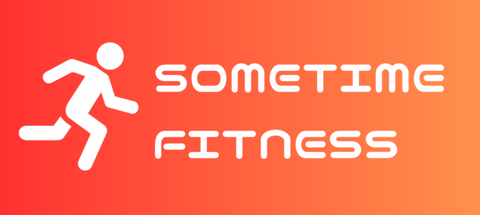

# Sometime Fitness

[](https://www.youtube.com/watch?v=piaNsc6ilBI)

## 製品概要

すぐ始められる運動を提案し、運動の習慣化を手伝ってくれるアプリ

### 背景(製品開発のきっかけ、課題等）

身近にこういう人がいました。（その人をペルソナにしています）

```
生活リズムも狂ってるし、体力もなくなってきた...社会人になって普通の生活習慣に戻せるか心配。睡眠の質も悪い気がする。
体力付けるために始めたランニングは、滅茶苦茶疲れるから続かなかった、筋トレはyoutubeでいい感じのを見つけたけど、効果が実感できないandいちいちyoutube開くのが面倒になってくる。
```

### 製品説明（具体的な製品の説明）

Sometime Fitnessは、運動を始めたいけれど何をすればよいか分からない人に、今日取り組む運動を提案するアプリです。運動レベルに合わせたメニューをすぐに始められ、タイマーに沿って運動できます。運動後は、運動時間・消費カロリー・獲得XP・ストリークを記録します。

### 特長

#### 1. 特長1

ホーム画面を開くとすぐにスタートボタンが表示されます。迷わずスタートできるよう、毎回たくさんのメニューから選ぶ必要がありません。

#### 2. 特長2

運動中は、種目名・体の動かし方・残り時間・全体の進み具合を確認できます。

#### 3. 特長3

運動の記録に応じてXP・レベル・ストリークを更新し、ホーム画面のカレンダーやレポートで継続状況を振り返れます。設定画面では、最大5種目のカスタムメニューも作成できます。

### 解決出来ること

運動を始めたいものの、メニュー選びや動画を探す手間が原因で続かないという課題を解決します。短時間で取り組める運動をすぐに始められ、運動した結果も記録できるため、習慣化を支援します。

### 今後の展望

運動の効果表示、週次・月次レポート、より多くのメニュー、他のユーザーとのつながりなどを追加し、運動を続けるきっかけを増やしていきます。運動レベルの診断やメニュー提案も、利用状況に合わせて改善します。

### 注力したこと（こだわり等）

- 運動を始めるまでの操作を少なくし、ホーム画面からすぐに運動を開始できる体験にこだわりました。
- 1回あたりのハードルを下げるために20秒、1種目をデフォルト設定にしています。
- 1種目の運動でも達成感を得られるよう、タイマー・休憩・レポート・XP・ストリークを一連の流れとして設計しました。

## 開発技術

### 活用した技術

#### API・データ

- Google OAuth 2.0（OpenID Connect）

#### フレームワーク・ライブラリ・モジュール

- React
- Vite
- TypeScript
- Hono / Node.js
- Firebase Firestore / Firebase Emulator Suite

#### デバイス

- Webブラウザ（PC・スマートフォン）

### 独自技術

#### ハッカソンで開発した独自機能・技術

- 運動レベルごとに、ユーザーがまだクリアしていない種目を「今日のメニュー」として1つだけ提案する仕組みを開発しました。ページを再読み込みしてもクリアするまで同じ種目を提示し、完了後に次の種目を抽選します。
- カスタムメニューでは、最大5種目・種目順・1種目あたりの時間を保存し、通常メニューと同じ運動・記録フローで利用できます。
- Google OAuthの認証情報をバックエンドに限定し、HttpOnly Cookieのセッションでログイン状態を管理しました。主な実装箇所は [oneExerciseMenu.ts](backend/src/services/oneExerciseMenu.ts)、[customMenu.ts](backend/src/services/customMenu.ts)、[progress.ts](backend/src/services/progress.ts)、[WorkoutScreen.tsx](frontend/src/screens/WorkoutScreen.tsx) です。
